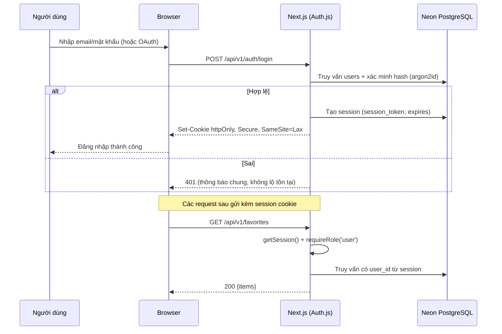

# P02 — AUTHORIZATION & SECURITY: WALE COOKING

> Thiết kế xác thực, phân quyền và bảo mật ở mức đặc tả. Tham chiếu **OWASP ASVS** (L1 toàn hệ thống; L2 cho xác thực).
> Tuân thủ [PRODUCT_CONSTITUTION.md](../P01/PRODUCT_CONSTITUTION.md) PC-09, PC-11; NFR-SEC/PRIV. Liên quan: [API_CONTRACT.md](./API_CONTRACT.md).

## 1. Authentication flow (Mermaid)

## 2. Session handling
- **Chiến lược:** **database session** (bảng `sessions`) — thu hồi được, không phụ thuộc JWT client.
- **Cookie:** `httpOnly`, `Secure`, `SameSite=Lax`, `path=/`, tên cookie do Auth.js quản lý.
- **Vòng đời:** `expires` (đề xuất 30 ngày), làm mới khi còn hiệu lực; logout xóa session server-side.
- **Không** lưu token nhạy cảm trong `localStorage`.

## 3. Authorization / RBAC

| Vai trò | Phạm vi |
| --- | --- |
| `guest` | Đọc công khai: trang chủ, thư viện, công thức `published`, tìm/lọc, điều chỉnh khẩu phần, chế độ nấu **không lưu**. |
| `user` | + Yêu thích, sổ tay, phiên nấu (lưu tiến độ), meal plan, shopping list. |
| `editor` | + Tạo/sửa công thức (nháp), duyệt & xuất bản, quản lý nguồn; **đề xuất** taxonomy (chờ chốt — B-P01-01). |
| `admin` | + Quản lý taxonomy chính thức, người dùng/phân quyền, audit, cấu hình hệ thống. |

**Thực thi (bắt buộc):**
1. Mọi Server Action/Route Handler nhạy cảm gọi `requireRole(...)` **trước** khi chạy use-case.
2. Role và `userId` **lấy từ session server-side**, **không** từ body/query/header do client gửi.
3. Kiểm tra quyền ở **tầng Application**; Presentation chỉ hiển thị theo quyền (không phải nguồn tin cậy).
4. *Vai trò `moderator`:* **chưa chốt** (O7) — không thêm quyền, không thêm bảng.

## 4. Data isolation (cô lập dữ liệu theo người dùng)
- Mọi truy vấn dữ liệu cá nhân (favorites, collections, notes, sessions, meal plans, shopping lists) **luôn** kèm `WHERE user_id = :sessionUserId`.
- Repository cho dữ liệu cá nhân nhận `userId` như tham số **bắt buộc**; không có phương thức "lấy tất cả".
- Kiểm tra quyền sở hữu trước khi sửa/xóa (không chỉ dựa vào id trong URL).
- Endpoint admin kiểm tra vai trò ở server; không lộ dữ liệu người dùng khác ngoài phạm vi vai trò.

## 5. Bảo vệ đầu vào & lỗ hổng phổ biến

| Rủi ro | Biện pháp |
| --- | --- |
| **SQL Injection** | Prisma parameterized queries; **không** nội suy SQL thô từ input. |
| **XSS** | Escape mặc định của React; **không** dùng `dangerouslySetInnerHTML` trừ nội dung đã sanitize (HTML từ CMS qua sanitizer). |
| **CSRF** | Server Actions có cơ chế bảo vệ của Next.js; Route Handler mutation yêu cầu `Origin`/`SameSite` + token khi cần. |
| **Input validation** | Zod ở server cho mọi entry; từ chối dữ liệu sai kiểu/quá dài. |
| **Broken access control** | `requireRole` + data isolation (§3, §4). |
| **Sensitive data exposure** | HTTPS bắt buộc; không log secret/PII; thông báo lỗi không lộ chi tiết. |
| **Dependency** | Dependency scanning trong CI (Dependabot/audit). |

## 6. Upload validation
- Kiểm tra **MIME thật** (magic bytes), không tin `Content-Type` client.
- **Giới hạn kích thước** (đề xuất ≤ 8 MB/ảnh), giới hạn kích thước pixel.
- Chỉ chấp nhận định dạng ảnh cho phép (`image/jpeg`, `image/png`, `image/webp`, `image/avif`).
- Lưu trữ ngoài Postgres (R2); tên file do server sinh (không dùng tên client) — xem [MEDIA_STORAGE.md](./MEDIA_STORAGE.md).
- Quét nội dung (tùy chọn, giai đoạn sau).

## 7. Rate limiting
- Áp dụng cho `/auth/*`, `/search*`, `/media/upload`, mutation ghi dữ liệu (bảng ở [API_CONTRACT.md](./API_CONTRACT.md) §13).
- MVP: giới hạn theo IP/user ở middleware (in-memory). Giai đoạn sau: Upstash Redis (đếm phân tán).
- Phản hồi `429` kèm `Retry-After`.

## 8. Secret management
- Bí mật (DB URL, R2 keys, Auth secret) chỉ ở **server env**, **không** commit vào repo, không có tiền tố `NEXT_PUBLIC_`.
- `.env` không được commit; cung cấp `.env.example` (không chứa giá trị thật).
- Trên nền tảng deploy: dùng biến môi trường mã hóa (Vercel/Cloudflare secrets + GitHub Actions secrets).
- Xoay khóa định kỳ; quyền R2 tối thiểu (chỉ bucket cần thiết).

## 9. Audit log
- Ghi `audit_logs` cho thao tác quan trọng: tạo/sửa/xuất bản/lưu trữ công thức, đổi vai trò, đổi taxonomy, xác minh nguồn.
- Trường: ai (`actor_id`), làm gì (`action`), đối tượng (`entity_type`,`entity_id`), thay đổi (`before`/`after`), thời gian, IP/UA (nếu có).
- Audit **tách** khỏi log kỹ thuật; chỉ `admin` xem được.

## 10. Privacy (NFR-PRIV)
- **Tối thiểu hóa dữ liệu:** chỉ thu thập email/tên/avatar cần thiết.
- Người dùng có quyền **xuất/xóa dữ liệu cá nhân** — cơ chế **chưa chốt** (B-P01-03/O6): ghi vào BLOCKERS; thiết kế để sẵn sàng (dữ liệu cá nhân có `user_id` + FK CASCADE có kiểm soát).
- Không theo dõi bên thứ ba mặc định; analytics (nếu có) phải thông báo/đồng thuận.

## 11. Backup & recovery (tóm tắt; chi tiết ở DEPLOYMENT_ARCHITECTURE.md)
- Neon: nhánh thời gian (branching) + backup định kỳ; **RPO ≤ 24h**, **RTO ≤ 4h** (NFR-BACKUP).
- Xuất nội dung (export) định kỳ để giảm lock-in (PC-11).
- Kiểm thử phục hồi định kỳ — ghi nhận kết quả, không tuyên bố đạt khi chưa thử.

## 12. Ma trận quyền ↔ endpoint (rút gọn)

| Endpoint | Guest | User | Editor | Admin |
| --- | :-: | :-: | :-: | :-: |
| GET /recipes, /recipes/{slug} | ✔ | ✔ | ✔ | ✔ |
| GET /search | ✔ | ✔ | ✔ | ✔ |
| POST /favorites, /cooking-sessions | — | ✔ | ✔ | ✔ |
| POST /recipes (nháp), /recipes/{id}/publish | — | — | ✔ | ✔ |
| POST /taxonomy terms | — | — | ⚠ đề xuất | ✔ |
| PATCH /admin/users/{id}/role | — | — | — | ✔ |
| POST /media/upload | — | — | ✔ | ✔ |

## 13. Checklist ASVS mức phù hợp (đề xuất — chưa kiểm thử)
- [ ] Xác thực: hash mật khẩu mạnh (argon2id/bcrypt), chống brute-force (rate limit), không lộ tồn tại tài khoản.
- [ ] Phiên: cookie an toàn, thu hồi được, timeout hợp lý.
- [ ] Kiểm soát truy cập: RBAC server-side + data isolation.
- [ ] Kiểm tra đầu vào & mã hóa đầu ra.
- [ ] Bảo mật file upload.
- [ ] Quản lý bí mật & cấu hình.
- [ ] Logging & audit (không log PII).
- [ ] Phòng chống lỗ hổng phổ biến (OWASP Top 10).

> **Không tuyên bố đạt ASVS** cho tới khi kiểm thử thực tế (ghi nhận trung thực — PC-02).
