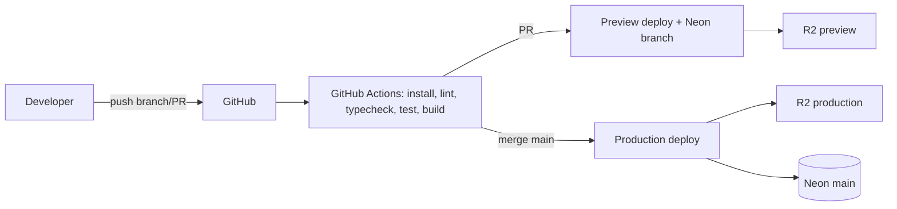

# P02 — DEPLOYMENT ARCHITECTURE: WALE COOKING

> Thiết kế môi trường & quy trình triển khai ở mức **đặc tả** (không triển khai thật trong P02). Bám stack đã chốt + gói miễn phí (NFR-FREE).
> Liên quan: [SYSTEM_ARCHITECTURE.md](./SYSTEM_ARCHITECTURE.md) · [AUTHORIZATION_SECURITY.md](./AUTHORIZATION_SECURITY.md) §11 · [03-de-xuat-cong-nghe.md](../P00/03-de-xuat-cong-nghe.md).

## 1. Môi trường

| Môi trường | Mục đích | Database | Ghi chú |
| --- | --- | --- | --- |
| **Local development** | Phát triển | Neon **dev branch** (hoặc Postgres local) | `pnpm dev`; dùng `.env.local` |
| **Test/CI** | Chạy test tự động | Neon **test branch** (ephemeral) hoặc Postgres trong CI | Migration + seed tối thiểu |
| **Preview** | Xem trước mỗi PR | Neon **branch theo PR** (copy-on-write) | R2 prefix/ bucket riêng cho preview |
| **Production** | Người dùng thật | Neon **main branch** | Bật backup/PITR; R2 bucket chính |

> **Neon branching** cho phép tách môi trường **rẻ** (copy-on-write) — phù hợp gói miễn phí (PC-11, NFR-FREE).

## 2. Quản lý biến môi trường

| Biến (ví dụ) | Phạm vi | Ghi chú |
| --- | --- | --- |
| `DATABASE_URL` | Server | Chuỗi kết nối Neon (pooled) |
| `DIRECT_URL` | Server | Kết nối trực tiếp cho migration |
| `AUTH_SECRET` | Server | Bí mật Auth.js |
| `AUTH_URL` / provider keys | Server | OAuth (nếu bật) |
| `R2_ACCOUNT_ID`, `R2_ACCESS_KEY_ID`, `R2_SECRET_ACCESS_KEY`, `R2_BUCKET`, `R2_PUBLIC_URL` | Server | R2 |
| `NEXT_PUBLIC_*` | Client | **Chỉ** giá trị không nhạy cảm (vd base URL public) |

- **Không** commit `.env`; cung cấp `.env.example` không chứa giá trị thật.
- Mỗi môi trường dùng secret riêng (không dùng chung key production cho preview).
- Quản lý qua Vercel/Cloudflare env + GitHub Actions secrets.

## 3. Prisma & migration

- **Prisma Migrate** cho schema; migration **versioned trong repo** (`prisma/migrations/`).
- `pnpm prisma generate` chạy trong CI/build để sinh client.
- Quy trình: phát triển → `prisma migrate dev` (local/dev branch) → `prisma migrate deploy` (CI/CD cho test/preview/prod).
- Migration phá vỡ tương thích → theo chiến lược **expand/contract** (thêm cột mới trước, bỏ cột cũ sau).
- Seed tối thiểu (taxonomy 9 trục + vài nguyên liệu mẫu) cho dev/test — **không** seed công thức giả vào production (BR-02).

## 4. Build & deploy

- **CI (GitHub Actions):** cài deps (pnpm), lint, typecheck, test, build; chặn merge nếu đỏ.
- **CD:** deploy từ Git. Đề xuất **Vercel Hobby** (tối ưu Next.js, phi thương mại — D1) **hoặc Cloudflare Pages/Workers** (không giới hạn băng thông) — chốt ở O2.
- **Build:** SSG/SSR/ISR cho nội dung; route động cho dữ liệu cá nhân.

## 5. Rollback
- **Application:** rollback về deployment trước (Vercel/Cloudflare hỗ trợ promote lại bản cũ).
- **Database:** dùng **migration tiến/lùi có kiểm soát**; tránh `DROP` trực tiếp; nhờ Neon branching để khôi phục.
- **Không** rewrite lịch sử git/migration đã phát hành.

## 6. Backup & restore
| Chỉ số | Mục tiêu (NFR-BACKUP) |
| --- | --- |
| RPO | ≤ 24 giờ |
| RTO | ≤ 4 giờ |
| Sao lưu | Tối thiểu hằng ngày |
| Kiểm thử phục hồi | Định kỳ (đề xuất hàng tháng) |
- Neon: instant restore ngắn hạn + branching; **PITR đầy đủ là trả phí** ở một số nền tảng → cơ chế sao lưu bổ sung (dump định kỳ ra object storage) **cần chốt** (xem BLOCKERS).
- **Export nội dung** định kỳ (JSON/SQL) để giảm lock-in.
- R2: versioning/bản sao theo chính sách bucket.

## 7. Monitoring & logging
- **Lỗi & hiệu năng:** Sentry (free tier) — adapter để thay thế được (O3).
- **Uptime:** dịch vụ ping ngoài (vd UptimeRobot free).
- **Log:** console có cấu trúc ở MVP; dịch vụ log (Axiom/Logtail/Better Stack) ở giai đoạn sau.
- **Cảnh báo:** sao lưu thất bại, lỗi 5xx tăng, chạm hạn mức free → cảnh báo admin.

## 8. Hạn mức gói miễn phí (cần theo dõi)
- **Neon Free:** 1 GB storage/project; 100 CU-giờ/tháng; 5 GB egress; scale-to-zero.
- **R2 Free:** 10 GB storage; 1M Class A + 10M Class B ops; egress $0.
- **Vercel Hobby:** ~100 GB transfer + 1M request/tháng; **chỉ phi thương mại**.
- **GitHub Actions:** free cho repo public (private có hạn mức phút).
> Số liệu theo thời điểm **11/2026** — **kiểm tra lại** trước khi deploy (B ghi ở BLOCKERS). Khi chạm trần → **suy giảm mềm**, không sập (NFR-FREE).

## 9. Kiểm thử trong pipeline (NFR-TEST)
- Unit (Domain/Application) → nhanh, không I/O.
- Integration (Infrastructure: repository/adapter với DB test) → dùng Neon test branch.
- E2E (luồng chính: xem công thức, đổi khẩu phần, chế độ nấu, CMS publish) → Playwright (đề xuất).
- Bao phủ đề xuất ≥ 70% cho module lõi.

## 10. Ràng buộc môi trường đã biết
- Sandbox dev **không có Docker** → tránh giả định container local ở giai đoạn đầu; dùng Neon branch/Postgres local không container.
- Tooling: Node 24, pnpm 10 (đã chốt **pnpm**).

## 11. Quy trình triển khai (tóm tắt)
1. Dev tạo PR → CI chạy (lint/typecheck/test/build) + Preview deploy (kèm Neon branch).
2. Review → merge vào `main` → Production deploy tự động.
3. `prisma migrate deploy` chạy trước khi app khởi động.
4. Revalidate cache/ISR cho nội dung thay đổi (xem [SYSTEM_ARCHITECTURE.md](./SYSTEM_ARCHITECTURE.md) §8).
5. Theo dõi lỗi/hạn mức; rollback nếu sự cố.

> **P02 không triển khai thật.** Không đăng ký dịch vụ trả phí, không tạo DB production.
