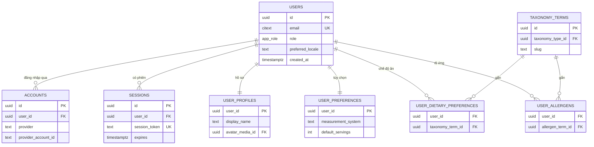
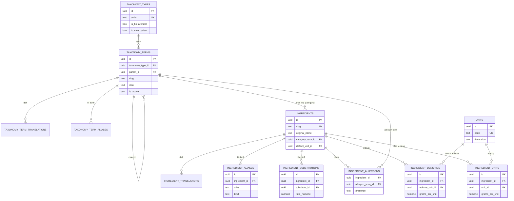
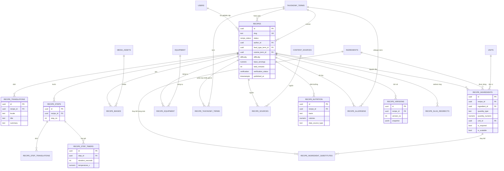
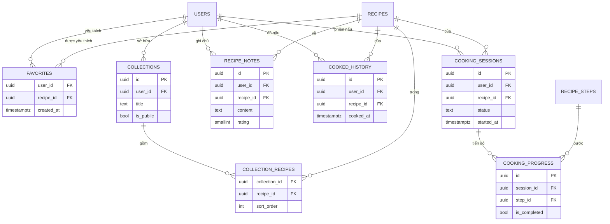
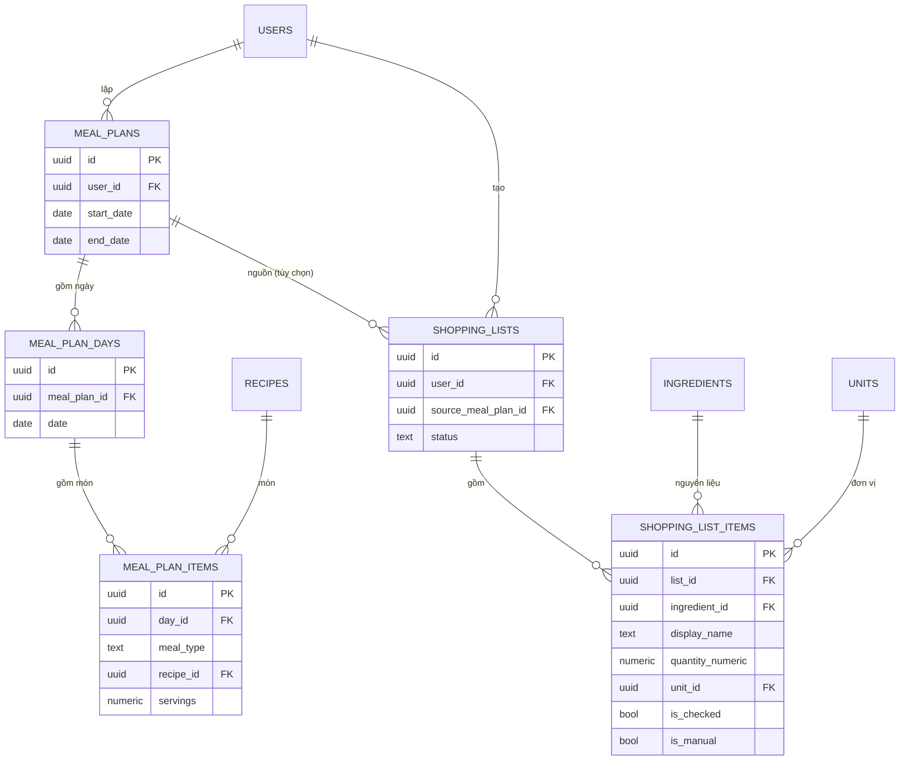
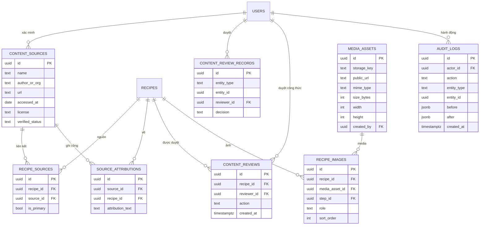

# P02 — ENTITY RELATIONSHIP DIAGRAM (ERD): WALE COOKING

> ERD Mermaid ở mức thiết kế. Để dễ đọc và đảm bảo syntax hợp lệ, ERD được **chia theo miền** (không phải một sơ đồ khổng lồ).
> Định nghĩa cột/ràng buộc đầy đủ: [DATABASE_SCHEMA.md](./DATABASE_SCHEMA.md). Ký hiệu Mermaid: `||` một, `o{` nhiều, `o|` không-hoặc-một.

## 1. Identity, Access & User Profile

> `verification_tokens` (Auth.js) không vẽ để gọn; xem [DATABASE_SCHEMA.md](./DATABASE_SCHEMA.md) §5.1.

## 2. Taxonomy & Ingredient

## 3. Recipe core

## 4. User Cookbook (favorites, collections, notes, cooking)

## 5. Meal Planner & Shopping List

## 6. Content Source, Media & Audit

## 7. Ghi chú ERD

- **Trục phân loại độc lập:** `taxonomy_types` chứa 9 mã trục; mỗi trục là một nhóm `taxonomy_terms` riêng — **không gộp** (BR-04).
- **food_type / cuisine** là FK **đơn** trên `recipes`; các trục còn lại (cooking_method, meal_type, dietary_preference, allergen) qua `recipe_taxonomy_terms` (nhiều giá trị).
- **Media tách khỏi Recipe:** `media_assets` là thực thể độc lập, `recipe_images` là liên kết (M19).
- **Audit tách khỏi nghiệp vụ:** `audit_logs`, `content_reviews`, `content_review_records` là log truy vết (M18).
- Không có phụ thuộc vòng giữa các thực thể theo nghĩa module (xem [MODULE_DESIGN.md](./MODULE_DESIGN.md) §3).
