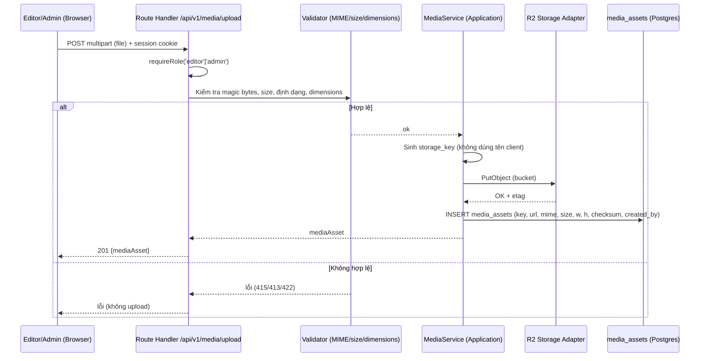

# P02 — MEDIA STORAGE: WALE COOKING

> Thiết kế lưu trữ media (ảnh) qua **adapter Cloudflare R2** (tương thích S3 API) ở mức đặc tả. **Không** lưu file ảnh trong PostgreSQL.
> Liên quan: [SYSTEM_ARCHITECTURE.md](./SYSTEM_ARCHITECTURE.md) §7 · [AUTHORIZATION_SECURITY.md](./AUTHORIZATION_SECURITY.md) §6 · [DATABASE_SCHEMA.md](./DATABASE_SCHEMA.md) §5.9 (`media_assets`).

## 1. Nguyên tắc
- Postgres **chỉ lưu metadata** (`media_assets`); **bytes** nằm ở R2.
- Truy cập qua **adapter** theo chuẩn S3 (PC-11) → thay được sang S3/Backblaze B2/MinIO mà không đổi lõi.
- Ảnh công khai phục vụ qua CDN/URL công khai; asset nháp/chưa xuất bản chỉ truy cập có kiểm soát.

## 2. Media upload flow (Mermaid)



## 3. Upload flow — hai phương án (chọn theo quy mô)

| | (A) Server-proxy — **MVP mặc định** | (B) Presigned URL — tùy chọn |
| --- | --- | --- |
| Luồng | Client → Route Handler → R2 | Client xin URL ký → PUT trực tiếp R2 → server xác nhận |
| Ưu | Đơn giản, kiểm soát/validate tập trung | Không tốn băng thông server, nhanh hơn |
| Nhược | Tốn băng thông server; giới hạn body | Cần endpoint presign + xác nhận metadata sau |
| Phù hợp | Ảnh editor/admin tải, tần suất thấp | Tải khối lượng lớn (giai đoạn sau) |

> **Quyết định:** MVP dùng **(A)**; ghi vào [ARCHITECTURE_DECISIONS.md](./ARCHITECTURE_DECISIONS.md) D-P02-06.

## 4. Download / truy cập
- **Public assets** (ảnh công thức đã xuất bản): URL công khai qua CDN, cache dài hạn (immutable khi có hash tên file).
- **Private/draft assets**: truy cập qua **signed URL** có hạn (hoặc proxy server) — không lộ ảnh chưa xuất bản.
- Kiểm tra quyền: ảnh `draft`/`in_review` chỉ `editor`/`admin` xem được.

## 5. Đặt tên file (key)
- Server sinh key: `recipes/{recipe_id}/{uuid}-{slug}.{ext}` hoặc `media/{yyyy}/{mm}/{uuid}.{ext}`.
- **Không** dùng tên file client (chống path traversal/ghi đè).
- Thêm hash nội dung (`checksum`) để dedupe và làm cache key bất biến.

## 6. Metadata (`media_assets`)
`id`, `storage_key` (UNIQUE), `public_url`, `mime_type`, `size_bytes`, `width`, `height`, `checksum` (sha256), `alt_text_default`, `status` (`active`/`archived`), `created_by`(FK users SET NULL), `created_at`. Liên kết tới công thức qua `recipe_images` (kèm `alt_text`, `role`, `sort_order`).

## 7. Validation media
- MIME thật (magic bytes): `image/jpeg`, `image/png`, `image/webp`, `image/avif`.
- Kích thước: ≤ 8 MB/ảnh (đề xuất); pixel tối đa hợp lý (vd ≤ 6000 px cạnh dài).
- Từ chối file thực thi/đa định dạng; strip metadata nhạy cảm (EXIF GPS) khi xử lý.
- Ảnh phải có `alt_text` trước khi gắn công thức xuất bản (PC-07).

## 8. Thumbnail & responsive images
- Sinh biến thể kích thước khi upload (hoặc on-the-fly qua CDN/Next Image): `thumb` (~320px), `md` (~768px), `lg` (~1280px), `original`.
- Dùng **`next/image`** với `srcset`/`sizes`; `loading="lazy"` cho ảnh dưới màn hình đầu; `priority` cho ảnh hero.
- Ưu tiên định dạng **WebP/AVIF** khi trình duyệt hỗ trợ.

## 9. Cache headers
- Asset bất biến (có hash): `Cache-Control: public, max-age=31536000, immutable`.
- Ảnh có thể thay thế: `max-age` ngắn + `ETag`/`stale-while-revalidate`.
- Public URL qua CDN; không cache CDN cho asset private.

## 10. Delete / archive policy
- **Mặc định archive** (`status='archived'`) thay vì xóa cứng → tránh hỏng tham chiếu.
- Chỉ xóa cứng khi **không còn tham chiếu** (`recipe_images`, avatar, v.v.).
- Khi xóa công thức (Admin): ảnh chỉ gỡ liên kết, không tự xóa asset nếu còn dùng chỗ khác.
- Không lưu/tái sử dụng nội dung/hình ảnh không được phép (PC-03).

## 11. Signed URL
- Dùng cho asset private/draft và tải xuống giới hạn: thời hạn ngắn (vd 5–15 phút), ký bằng khóa R2 (S3 SigV4).
- Không nhúng khóa vào client; server sinh URL ký khi có quyền.

## 12. Chuyển nhà cung cấp (portability)
```
StoragePort (Domain)
  put(key, bytes, contentType): {url}
  getSignedUrl(key, ttl): string
  delete(key): void
  publicUrl(key): string
        ▲
        │ implements
R2StorageAdapter (S3-compatible)  ←── MVP
   (thay bằng S3Adapter/B2Adapter/MinIOAdapter — chỉ đổi cấu hình endpoint/credentials)
```
- Vì dùng **chuẩn S3 API**, đổi nhà cung cấp = đổi endpoint + keys, **không** đổi Application/Domain.
- Kiểm thử: contract test cho `StoragePort` chạy với adapter giả (in-memory) hoặc MinIO local khi cần.

## 13. Truy vết
| FR | Liên quan media |
| --- | --- |
| FR-03 | Ảnh đại diện, ảnh hướng dẫn theo bước |
| FR-17 | Upload/quản lý ảnh trong CMS/Admin |
| FR-19 | Ảnh OG cho chia sẻ; ảnh tối ưu cho SEO |
