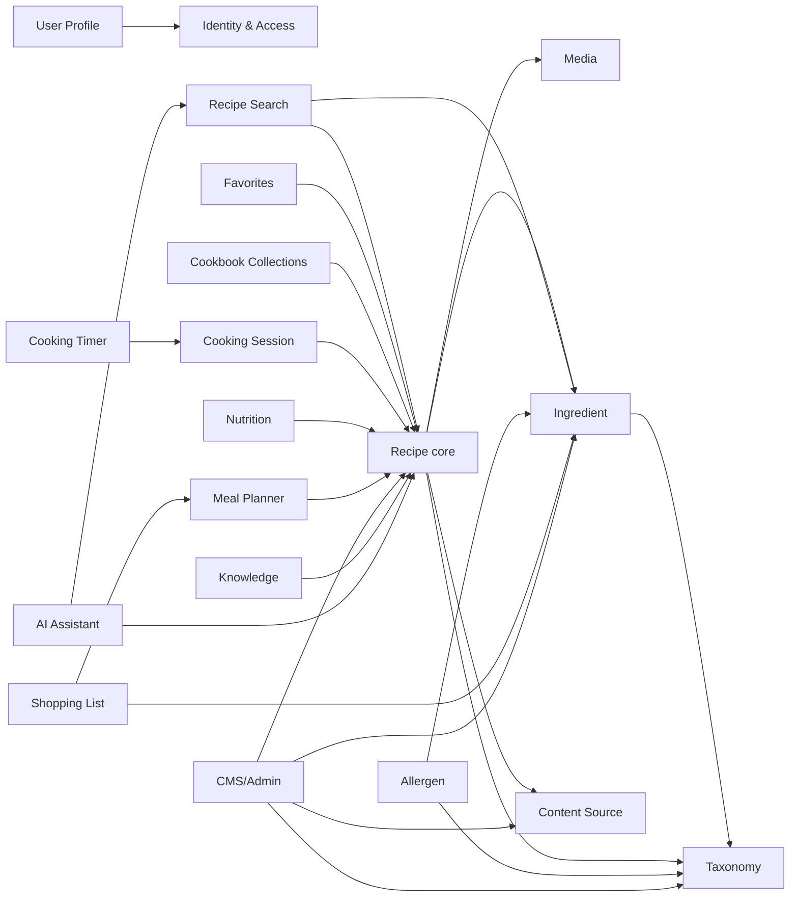

# P02 — MODULE DESIGN: WALE COOKING

> Thiết kế module nghiệp vụ ở mức đặc tả. Mỗi module: **Mục đích · Trách nhiệm · Dữ liệu sở hữu · Interface · Phụ thuộc · Không được truy cập trực tiếp**.
> Phân biệt module **bắt buộc MVP** và **triển khai sau**. Liên quan: [SYSTEM_ARCHITECTURE.md](./SYSTEM_ARCHITECTURE.md) · [DATABASE_SCHEMA.md](./DATABASE_SCHEMA.md).

## 1. Nguyên tắc module hóa

1. **Sở hữu dữ liệu:** mỗi bảng có **đúng một** module sở hữu (owner). Module khác **không truy vấn trực tiếp** bảng của module bạn — phải qua interface.
2. **Phụ thuộc một chiều, không vòng:** nếu A gọi B thì B không gọi lại A (xem sơ đồ §3).
3. **Giao tiếp qua interface/port**, không qua bảng thô.
4. **MVP trước, mở rộng sau:** module chưa cần cho MVP vẫn có thiết kế nhưng đánh dấu rõ.

## 2. Danh mục module

| # | Module | Pha | FR chính |
| --- | --- | --- | --- |
| M01 | Identity & Access | MVP | FR-16, FR-20 |
| M02 | User Profile & Preferences | MVP | FR-16, FR-11 |
| M03 | Recipe (core) | MVP | FR-03, FR-08 |
| M04 | Ingredient | MVP | FR-03, FR-06, FR-08 |
| M05 | Taxonomy | MVP | FR-04, FR-07 |
| M06 | Cuisine & Region | MVP (nằm trong Taxonomy) | FR-04 |
| M07 | Cooking Method | MVP (nằm trong Taxonomy) | FR-04, FR-07 |
| M08 | Recipe Search | MVP | FR-05, FR-06, FR-07 |
| M09 | Recipe Collection & Cookbook | MVP (favorites) / sau (collections) | FR-11 |
| M10 | Favorites | MVP | FR-11 |
| M11 | Cooking Session & Progress | MVP (cơ bản) | FR-09 |
| M12 | Cooking Timer | MVP (client) | FR-09 |
| M13 | Meal Planner | Sau (nâng cao) | FR-12 |
| M14 | Shopping List | Sau (nâng cấp) | FR-13 |
| M15 | Nutrition | Sau (nâng cấp) | FR-14 |
| M16 | Allergen | Sau (nâng cấp, nền MVP) | FR-14, FR-07 |
| M17 | Content Source & Copyright | MVP | FR-18 |
| M18 | CMS / Admin | MVP (cơ bản) | FR-17 |
| M19 | Media | MVP | FR-03, FR-17 |
| M20 | Notification | Sau (chỉ khi cần) | FR-09 (nhắc timer) |
| M21 | Knowledge / Article | Sau (nâng cấp) | FR-10 |
| M22 | AI Assistant | Sau (nâng cao) | FR-15 |

> M06/M07 là **view nghiệp vụ trên M05 Taxonomy**, không phải storage riêng (tránh trùng bảng — xem §5 DATABASE_SCHEMA).

## 3. Module Dependency (Mermaid) — không có vòng

**Kiểm tra vòng:** mọi cạnh đi theo thứ tự M01→M02; M05→M04→M03; M03 là **lõi bất động** (không trỏ ra ngoài trừ Media/Source/Taxonomy/Ingredient). Không tồn tại đường quay lại → **không có phụ thuộc vòng**.

## 4. Đặc tả module

### M01 — Identity & Access `MVP`
- **Mục đích:** xác thực & phiên người dùng.
- **Trách nhiệm:** đăng ký/đăng nhập/đăng xuất, phiên, vai trò (RBAC), kiểm tra quyền server-side.
- **Dữ liệu sở hữu:** `users`, `accounts`, `sessions`, `verification_tokens`.
- **Interface:** `getSession()`, `requireUser()`, `requireRole(role)`, `AuthPort`.
- **Phụ thuộc:** Auth.js, Prisma (infra).
- **Không cho truy cập trực tiếp:** không module nào truy vấn `sessions`/`accounts`; dùng `requireRole`.

### M02 — User Profile & Preferences `MVP`
- **Mục đích:** hồ sơ & tùy chọn cá nhân.
- **Trách nhiệm:** hiển thị tên/ảnh, ngôn ngữ ưa thích, hệ đo lường, chế độ ăn & dị ứng của người dùng (phục vụ lọc).
- **Dữ liệu sở hữu:** `user_profiles`, `user_preferences`, `user_dietary_preferences`, `user_allergens`.
- **Interface:** `ProfileService.get/update`, `PreferenceService`.
- **Phụ thuộc:** M01, M05 (taxonomy diet/allergen).
- **Không cho truy cập trực tiếp:** module khác đọc tùy chọn qua service, không đọc bảng.

### M03 — Recipe (core) `MVP`
- **Mục đích:** lõi thực thể công thức.
- **Trách nhiệm:** vòng đời công thức (draft→review→published→archived), bước, khẩu phần gốc, mô tả, dịch, ảnh liên kết; **miền sở hữu quy tắc publish** (BR-01/03/13).
- **Dữ liệu sở hữu:** `recipes`, `recipe_translations`, `recipe_steps`, `recipe_step_translations`, `recipe_step_timers`, `recipe_images`, `recipe_taxonomy_terms`, `recipe_equipment`, `recipe_versions`.
- **Interface:** `RecipeRepository`, `RecipeService.getPublished(slug, locale)`, `PublishPolicy`.
- **Phụ thuộc:** M04 (ingredient), M05 (taxonomy), M17 (source), M19 (media).
- **Không cho truy cập trực tiếp:** module khác không ghi vào `recipes`; qua `RecipeService`.

### M04 — Ingredient `MVP`
- **Mục đích:** từ điển nguyên liệu.
- **Trách nhiệm:** tên đa ngôn ngữ/địa phương/tên gốc, bí danh, danh mục, quan hệ thay thế, mật độ (nếu có), liên kết dị ứng.
- **Dữ liệu sở hữu:** `ingredients`, `ingredient_translations`, `ingredient_aliases`, `ingredient_substitutions`, `ingredient_allergens`, `ingredient_densities`, `ingredient_units`.
- **Interface:** `IngredientRepository`, `SubstitutionService`.
- **Phụ thuộc:** M05.
- **Không cho truy cập trực tiếp:** Recipe không lưu tên nguyên liệu dạng text cứng nếu có entity — xem DATABASE_SCHEMA §5.3.

### M05 — Taxonomy `MVP`
- **Mục đích:** quản lý **các trục phân loại độc lập** bằng dữ liệu.
- **Trách nhiệm:** types + terms cho Food type, Cuisine, Country, Region, Ingredient Category, Cooking Method, Meal Type, Dietary Preference, Allergen; slug, icon, alias, bật/tắt, cha-con, đa ngôn ngữ.
- **Dữ liệu sở hữu:** `taxonomy_types`, `taxonomy_terms`, `taxonomy_term_translations`, `taxonomy_term_aliases`.
- **Interface:** `TaxonomyRepository`, `TaxonomyService.termsOf(type)`.
- **Phụ thuộc:** — (nền).
- **Không cho truy cập trực tiếp:** cấm hardcode danh mục ở frontend (BR-15).

### M06 — Cuisine & Region `MVP (view trên M05)`
- Là **taxonomy type** `cuisine` với quan hệ **cha-con** (`country` → `region`). Không có bảng riêng.

### M07 — Cooking Method `MVP (nằm trong M05)`
- Là **taxonomy type** `cooking_method`. Không có bảng riêng.

### M08 — Recipe Search `MVP`
- **Mục đích:** tìm & lọc (FR-05/06/07).
- **Trách nhiệm:** chuẩn hóa truy vấn (bỏ dấu), khớp tên/alias/nguyên liệu, xếp hạng, filter, tìm-theo-nguyên-liệu (thiếu/thay thế).
- **Dữ liệu sở hữu:** `recipe_search_index` (materialized view/index; xem SEARCH_ARCHITECTURE).
- **Interface:** `SearchPort`, `SearchService`.
- **Phụ thuộc:** M03, M04 (đọc).
- **Không cho truy cập trực tiếp:** Search **không** ghi vào `recipes`.

### M09 — Recipe Collection & Cookbook `favorites: MVP · collections: sau`
- **Dữ liệu:** `collections`, `collection_recipes`, `recipe_notes`, `cooked_history`. **Interface:** `CollectionService`.
- **Phụ thuộc:** M03, M01.

### M10 — Favorites `MVP`
- **Dữ liệu:** `favorites`. **Interface:** `FavoriteService.toggle(userId, recipeId)`.
- **Phụ thuộc:** M03, M01.

### M11 — Cooking Session & Progress `MVP (cơ bản)`
- **Dữ liệu:** `cooking_sessions`, `cooking_progress`. **Interface:** `CookingSessionService`.
- **Phụ thuộc:** M03, M01. Lưu tiến độ chỉ khi đã đăng nhập (BR-10).

### M12 — Cooking Timer `MVP (client-side)`
- **Trách nhiệm:** đếm ngược phía client (dựa mốc thời gian thực), thông báo khi hết (nếu được cấp quyền). Không cần bảng riêng; dùng dữ liệu `recipe_step_timers`.
- **Phụ thuộc:** M11.

### M13 — Meal Planner `sau (nâng cao)`
- **Dữ liệu:** `meal_plans`, `meal_plan_days`, `meal_plan_items`. **Interface:** `MealPlanService`.
- **Phụ thuộc:** M03, M01.

### M14 — Shopping List `sau (nâng cấp)`
- **Dữ liệu:** `shopping_lists`, `shopping_list_items`. **Interface:** `ShoppingListService`.
- **Phụ thuộc:** M04, M13. **Quy tắc gộp:** chỉ gộp khi đơn vị cùng chiều; không cộng mù (BR-06/07).

### M15 — Nutrition `sau (nâng cấp)`
- **Dữ liệu:** `recipe_nutrition`. Phân biệt measured/calculated/estimated/unknown.

### M16 — Allergen `nền MVP · hiển thị nâng cấp`
- **Dữ liệu:** `taxonomy_terms` (type=allergen) + `ingredient_allergens` + `recipe_allergens`.
- **Quy tắc:** cảnh báo dẫn xuất từ thành phần thực tế (BR-09); không suy đoán.

### M17 — Content Source & Copyright `MVP`
- **Dữ liệu:** `content_sources`, `recipe_sources`, `source_attributions`, `content_review_records`. **Interface:** `SourceService`.
- **Phụ thuộc:** M03. **Quy tắc:** chặn publish nếu thiếu nguồn khi không phải nội dung gốc (BR-03).

### M18 — CMS / Admin `MVP (cơ bản)`
- **Trách nhiệm:** CRUD công thức/nguyên liệu/taxonomy, duyệt & xuất bản, quản lý người dùng.
- **Dữ liệu:** dùng interface của M03/M04/M05/M17 + bảng audit (`content_reviews`, `audit_logs`).
- **Phụ thuộc:** M01 (RBAC), M03, M04, M05, M17, M19.
- **Không cho truy cập trực tiếp:** CMS không tự viết truy vấn chéo; gọi service của module sở hữu.

### M19 — Media `MVP`
- **Dữ liệu:** `media_assets`. **Interface:** `StoragePort`, `MediaService.upload/attach`.
- **Phụ thuộc:** R2 adapter (infra). Không lưu file trong Postgres (xem MEDIA_STORAGE).

### M20 — Notification `sau (chỉ khi cần)`
- Nhắc timer/hết giờ qua Web Notification (client) — MVP dùng quyền trình duyệt, chưa cần email/push server.

### M21 — Knowledge / Article `sau (nâng cấp)` · M22 — AI Assistant `sau (nâng cao)`
- M21: `knowledge_articles` + translations (FR-10). M22: dựa trên Search/Recipe, tuân PC-13/PC-14, **tùy chọn** (FR-15).

## 5. Bảng tra module ↔ dữ liệu sở hữu

| Bảng | Module sở hữu |
| --- | --- |
| users, accounts, sessions, verification_tokens | M01 |
| user_profiles, user_preferences, user_dietary_preferences, user_allergens | M02 |
| recipes, recipe_translations, recipe_steps, recipe_step_translations, recipe_step_timers, recipe_images, recipe_taxonomy_terms, recipe_equipment, recipe_versions | M03 |
| ingredients, ingredient_translations, ingredient_aliases, ingredient_substitutions, ingredient_allergens, ingredient_densities, ingredient_units, units, unit_translations, unit_conversions | M04 |
| taxonomy_types, taxonomy_terms, taxonomy_term_translations, taxonomy_term_aliases | M05 |
| favorites | M10 |
| collections, collection_recipes, recipe_notes, cooked_history | M09 |
| cooking_sessions, cooking_progress | M11 |
| meal_plans, meal_plan_days, meal_plan_items | M13 |
| shopping_lists, shopping_list_items | M14 |
| recipe_nutrition | M15 |
| content_sources, recipe_sources, source_attributions, content_review_records | M17 |
| content_reviews, audit_logs | M18 |
| media_assets | M19 |
