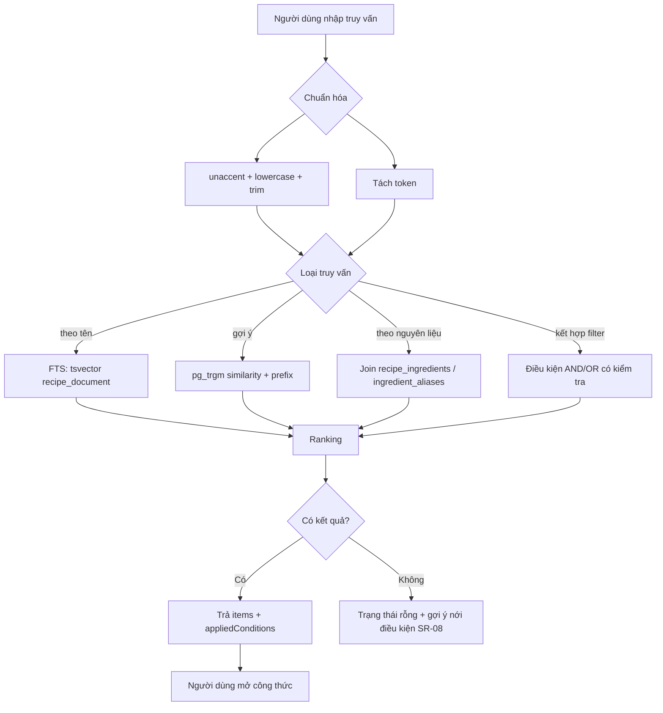

# P02 — SEARCH ARCHITECTURE: WALE COOKING

> Kiến trúc tìm kiếm cho MVP, ưu tiên **tiết kiệm & ít vận hành**. Đánh giá PostgreSQL FTS + `pg_trgm` **trước** khi cân nhắc dịch vụ ngoài.
> Liên quan: [BUSINESS_RULES.md](../P01/BUSINESS_RULES.md) SR-01…SR-08 · [FUNCTIONAL_REQUIREMENTS.md](../P01/FUNCTIONAL_REQUIREMENTS.md) FR-05/06/07.

## 1. Quyết định: dùng PostgreSQL Full-Text Search + pg_trgm cho MVP

| Phương án | Đánh giá |
| --- | --- |
| **Postgres FTS + `pg_trgm` + `unaccent`** (chọn) | $0, không thêm hạ tầng, dữ liệu nhất quán (không sync), đủ cho quy mô ~10.000 công thức; `pg_trgm` xử lý khớp mờ/typo nhẹ; `unaccent` xử lý dấu tiếng Việt. Nhược: tiếng Việt cần cấu hình tách từ. |
| Meilisearch / Typesense | Ranking/typo tốt hơn, nhưng **thêm service** (self-host/cloud) và **đồng bộ dữ liệu** → không cần ở MVP. |
| Algolia | Mạnh nhưng **đắt** + lock-in → loại. |
| AI/Semantic search | **Không làm ở MVP** (PC-14; yêu cầu prompt: không tạo AI Search phức tạp khi Postgres đủ). |

> **Nguyên tắc:** chỉ nâng cấp lên search engine chuyên dụng **khi có dữ liệu đo cho thấy Postgres không đủ** (số liệu thực, không phỏng đoán). Adapter search được thiết kế để thay thế được (xem §8).

## 2. Search flow (Mermaid)



## 3. Chuẩn hóa tiếng Việt (có dấu/không dấu)

- Cài extension: `unaccent`, `pg_trgm`, `pgcrypto`.
- **Trường tìm kiếm lưu bản chuẩn hóa:** `search_text = lower(unaccent(coalesce(title,'') || ' ' || coalesce(summary,'')))`.
- Người dùng gõ **có dấu hoặc không dấu** đều khớp: chuẩn hóa cả truy vấn lẫn tài liệu qua `unaccent`.
  - vd "bánh mì" ≡ "banh mi" (SR-01).
- **Lưu ý tách từ tiếng Việt:** Postgres FTS không có từ điển tiếng Việt sẵn; dùng cấu hình `simple` (không stemming) + `unaccent` + `pg_trgm` để bù. Ghi nhận là điểm hạn chế đã biết (không over-engineer).

## 4. Tokenization & chỉ mục

- **Cấu hình FTS:** `simple` (không stemming tiếng Việt) sau khi `unaccent`.
- **Tài liệu tìm kiếm gộp (denormalized):** một materialized view / cột `tsvector` tổng hợp từ:
  - `recipe_translations.title`, `summary`, `description` (vi + en),
  - tên nguyên liệu + alias,
  - tên taxonomy (cuisine, food_type, cooking_method, meal_type, diet),
  - `recipes.slug`.
- **`recipe_search_documents`** (view/materialized view) — `recipe_id`, `locale`, `search_text text`, `search_vector tsvector`, `popularity numeric` (từ lượt xem/lưu **thực**).
- **Index:**
  - `GIN(search_vector)` cho FTS.
  - `GIN(search_text gin_trgm_ops)` cho khớp mờ.
  - Index thường cho các cột lọc (`status`, `total_minutes`, `difficulty`, FK taxonomy).

**Refresh:** làm mới view khi publish/update recipe (on-demand qua job nhẹ hoặc trigger `AFTER INSERT/UPDATE` giới hạn) — tránh refresh toàn bộ.

## 5. Alias & synonyms

- Nguồn alias: `ingredient_aliases` (synonym/local/search), `taxonomy_term_aliases`.
- Khi truy vấn, mở rộng token qua alias map trước khi khớp (vd "cà chua" ↔ "tomato", "hành tây" ↔ "hành củ") — SR-03.
- Không dùng số liệu giả để đẩy kết quả.

## 6. Ranking (SR-07)

Điểm xếp hạng theo thứ tự ưu tiên:
1. **Khớp chính xác tên** (`title` = query) > **khớp một phần** (trigram/prefix).
2. **Độ phủ nguyên liệu** (khi tìm theo nguyên liệu) — cao hơn xếp trước.
3. **Mức phổ biến** (`popularity` từ lượt xem/lưu **thực**).
4. **Mới cập nhật** (`published_at`/`updated_at`).

Công thức gợi ý (SQL, mức thiết kế):
```
score = w_title * ts_rank(search_vector, query)
      + w_trgm  * similarity(title, unaccent(query))
      + w_cov   * ingredient_coverage_ratio
      + w_pop   * normalized_popularity
      + w_rec   * recency_factor
```
> Trọng số (`w_*`) cấu hình được; tinh chỉnh bằng dữ liệu đo sau, không phỏng đoán.

## 7. Filter, ingredient matching, fallback

- **Filter (FR-07):** thời gian, độ khó, chế độ ăn, dị ứng, dụng cụ — kết hợp **AND** giữa các trục, **OR** trong một trục; phản ánh vào URL (SR-05).
- **Ingredient matching (FR-06):** so tập nguyên liệu người dùng với `recipe_ingredients` (bắt buộc vs tùy chọn — BR-08):
  - `matched = user ∩ required`,
  - `missing = required \ user` (hiển thị),
  - `substitutions = ingredient_substitutions` cho nguyên liệu thiếu (SR-06),
  - chế độ "chỉ nấu được ngay" = `missing = ∅`.
- **Truy vấn ngôn ngữ tự nhiên:** quy đổi thành **điều kiện kiểm tra được** (vd "món chay nhanh dưới 30 phút" → `dietary=dietary_preference:chay AND total_minutes ≤ 30`); **không** trả kết quả ngoài điều kiện.
- **Fallback khi 0 kết quả:** trạng thái rỗng + gợi ý nới điều kiện (bỏ filter, bỏ nguyên liệu, sửa chính tả qua `pg_trgm`). **Không** bịa kết quả (SR-08).

## 8. Adapter & khả năng thay thế

```
SearchPort (Domain interface)
  search(query: SearchQuery): SearchResult
  suggest(prefix: string): string[]
  byIngredients(input): IngredientMatchResult
        ▲
        │ implements
PostgresSearchAdapter (Infrastructure)  ←── MVP
   (thay bằng MeilisearchAdapter/TypesenseAdapter khi cần, không đổi Application/Domain)
```

## 9. Không có kết quả — hành vi chuẩn (SR-08)
- Hiển thị thông báo rõ, **không** hiển thị công thức không tồn tại.
- Gợi ý: sửa chính tả (trigram), bỏ bớt điều kiện, hoặc gợi ý món gần nghĩa.
- Không tự sinh công thức để "lấp" trạng thái rỗng (BR-02).

## 10. Truy vết SR ↔ thực thi
| Quy tắc | Thực thi |
| --- | --- |
| SR-01 có/không dấu | `unaccent` hai chiều |
| SR-02 tên EN/tên gốc | gộp `recipe_translations` (en) + `ingredients.original_name` vào tài liệu |
| SR-03 bí danh | `ingredient_aliases`, `taxonomy_term_aliases` |
| SR-04 theo nguyên liệu | join `recipe_ingredients` + alias |
| SR-05 nhiều điều kiện | cấu trúc AND/OR + phản ánh URL |
| SR-06 thiếu/thay thế | ingredient matching + `ingredient_substitutions` |
| SR-07 xếp hạng | công thức `score` ở §6 |
| SR-08 không kết quả | §9 |
