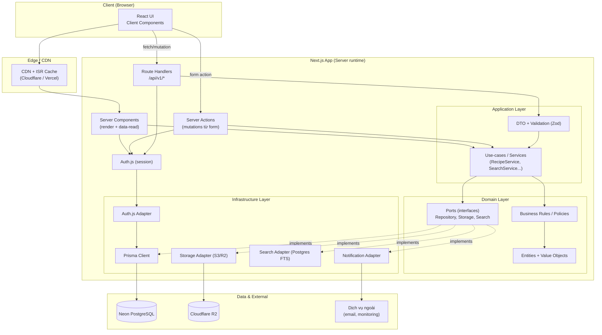
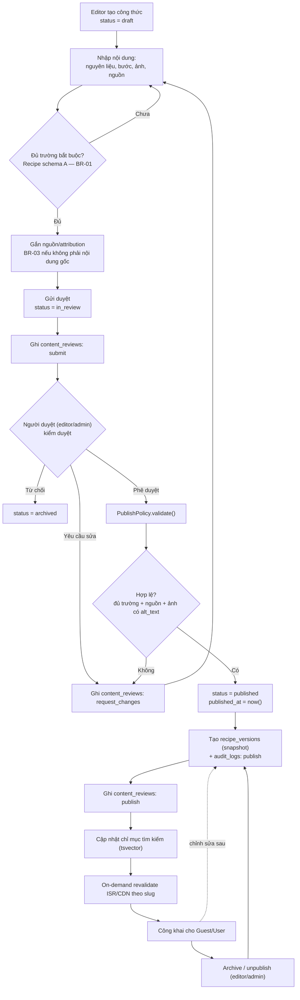

# P02 — SYSTEM ARCHITECTURE: WALE COOKING

> Thiết kế kiến trúc hệ thống ở mức **đặc tả** (chưa viết code ứng dụng, chưa tạo database production).
> Tuân thủ [PRODUCT_CONSTITUTION.md](../P01/PRODUCT_CONSTITUTION.md) và stack đã chốt tại [03-de-xuat-cong-nghe.md](../P00/03-de-xuat-cong-nghe.md).
> Liên quan: [MODULE_DESIGN.md](./MODULE_DESIGN.md) · [DATABASE_SCHEMA.md](./DATABASE_SCHEMA.md) · [API_CONTRACT.md](./API_CONTRACT.md) · [ARCHITECTURE_DECISIONS.md](./ARCHITECTURE_DECISIONS.md).

## 1. Mục tiêu & ràng buộc kiến trúc

**Mục tiêu:** module hóa rõ ràng; tách **Presentation / Application / Domain / Infrastructure**; business logic không phụ thuộc trực tiếp nhà cung cấp; thay được Neon/R2/Auth.js qua adapter; **không abstraction quá mức**.

**Ràng buộc (đã chốt, không thay đổi):**
- Stack lớp rời: Next.js (App Router, TypeScript) + Prisma + Neon PostgreSQL + Auth.js + Cloudflare R2, quản lý bằng **pnpm**.
- MVP đơn giản nhưng có đường mở rộng rõ ràng; vận hành trong gói miễn phí (NFR-FREE).
- Phi thương mại (D1). Design Direction "WALE COOKING — Pastel Mint" (D7).

**Nguyên tắc chi phối:** mọi phụ thuộc đi **một chiều** từ ngoài vào trong (Presentation → Application → Domain); Domain không biết đến Next.js/Prisma/R2 (PC-10, PC-11).

## 2. Kiến trúc tổng thể (Mermaid)

**Đọc sơ đồ:** mũi tên liền = phụ thuộc lúc chạy; mũi tên nét đứt `-.implements.->` = lớp Infrastructure **hiện thực** Port do Application/Domain định nghĩa (đảo ngược phụ thuộc — Dependency Inversion, phục vụ PC-11).

## 3. Các Layer — trách nhiệm, quyền phụ thuộc

### 3.1. Presentation Layer
- **Trách nhiệm:** render UI, thu thập input, gọi Application qua Server Actions/Route Handlers, hiển thị trạng thái loading/lỗi; **không** chứa business rule.
- **Thành phần:** Server Components, Client Components, layout, form, design tokens (Pastel Mint).
- **Được phép phụ thuộc:** Application Layer (qua DTO/interface công khai), tiện ích trình bày thuần.
- **Bị cấm:** truy vấn Prisma trực tiếp; truy cập biến môi trường bí mật (ngoài `NEXT_PUBLIC_*`); gọi R2 bằng secret.
- **Giao tiếp:** gọi use-case; nhận DTO đã validate.
- **Xử lý lỗi:** hiển thị lỗi đã chuẩn hóa (error boundary + trạng thái rỗng/thân thiện), không lộ stack trace.
- **Kiểm thử độc lập:** component test (render + interaction) với use-case giả (mock).

### 3.2. Application Layer
- **Trách nhiệm:** điều phối use-case (orchestration): xác thực quyền, gọi Domain, gọi Port, giao dịch; map entity ↔ DTO.
- **Thành phần:** `RecipeService`, `SearchService`, `MealPlanService`, `MediaService`…; DTO + schema Zod.
- **Được phép phụ thuộc:** Domain (entities, policies, ports), thư viện thuần.
- **Bị cấm:** import Prisma/Next.js/`@aws-sdk` trực tiếp; đọc request/response HTTP thô.
- **Giao tiếp:** nhận lệnh/truy vấn đã validate; trả DTO hoặc lỗi miền (domain error).
- **Xử lý lỗi:** ném lỗi miền có mã (`DomainError`) → Presentation map sang HTTP status.
- **Kiểm thử độc lập:** unit test use-case với port giả (in-memory repository); không cần DB.

### 3.3. Domain Layer
- **Trách nhiệm:** thực thể, value object (Quantity, Unit, PortionScaler), quy tắc nghiệp vụ (BR-01…BR-15), chính sách (publish policy, scaling policy, allergen policy).
- **Thành phần:** entity, aggregate, policy, port interface (Repository/Storage/Search).
- **Được phép phụ thuộc:** chỉ TypeScript chuẩn + thư viện thuần (không I/O).
- **Bị cấm:** Prisma, Next.js, R2/S3, HTTP, timer hệ thống trực tiếp.
- **Giao tiếp:** hàm thuần (pure functions) — nhận dữ liệu, trả kết quả.
- **Xử lý lỗi:** trả lỗi miền có kiểu; không ném lỗi hạ tầng.
- **Kiểm thử độc lập:** unit test thuần, không cần DB/network — **nơi đặt phần lớn test** (NFR-TEST).

### 3.4. Infrastructure Layer
- **Trách nhiệm:** hiện thực Port (Prisma repository, R2 storage adapter, Postgres FTS search adapter, mail adapter), cấu hình kết nối, migration.
- **Thành phần:** `PrismaRecipeRepository`, `R2StorageAdapter`, `PostgresSearchAdapter`…
- **Được phép phụ thuộc:** Domain (interface), thư viện hạ tầng (Prisma, AWS SDK), cấu hình môi trường.
- **Bị cấm:** chứa business rule; gọi ngược Presentation.
- **Giao tiếp:** hiện thực interface; map row DB ↔ entity.
- **Xử lý lỗi:** dịch lỗi hạ tầng (Prisma/S3) → lỗi miền có nghĩa.
- **Kiểm thử độc lập:** integration test với DB test (Neon branch / container-less Postgres) hoặc contract test cho adapter.

### 3.5. Database Layer
- **Trách nhiệm:** lưu trữ bền vững (Postgres), ràng buộc, index, migration.
- **Truy cập:** chỉ qua Prisma trong Infrastructure. **Không** truy cập từ browser.
- Xem chi tiết [DATABASE_SCHEMA.md](./DATABASE_SCHEMA.md).

### 3.6. Authentication & Authorization
- Auth.js giữ session; **kiểm tra quyền ở server** (Server Action/Route Handler/middleware) trước khi gọi use-case.
- Chi tiết: [AUTHORIZATION_SECURITY.md](./AUTHORIZATION_SECURITY.md).

### 3.7. Media Storage · 3.8. Search · 3.9. CMS/Admin · 3.10. External Services
- Media: adapter R2 qua chuẩn S3 — [MEDIA_STORAGE.md](./MEDIA_STORAGE.md).
- Search: Postgres FTS + `pg_trgm` — [SEARCH_ARCHITECTURE.md](./SEARCH_ARCHITECTURE.md).
- CMS/Admin: module CMS (MVP: admin tự viết trong Next.js; Payload là tùy chọn nâng cấp) — [MODULE_DESIGN.md](./MODULE_DESIGN.md).
- External: email/thông báo + monitoring, đặt sau **adapter** để thay thế được.

## 4. Quy tắc Next.js: Server vs Client, Actions vs Route Handlers

### 4.1. Khi nào dùng Server Component vs Client Component
| Dùng **Server Component** khi | Dùng **Client Component** (`"use client"`) khi |
| --- | --- |
| Đọc dữ liệu công khai/đã cache; render nội dung công thức, danh sách, SEO. | Cần state/event (bộ lọc tương tác, slider khẩu phần, timer, đếm giờ nấu). |
| Trang ưu tiên SEO + tốc độ (FR-01, FR-02, FR-03, FR-19). | Tương tác cục bộ (dropdown, modal, optimistic favorite). |
| Không cần `useState`/`useEffect`. | Cần API trình duyệt (Notification cho timer, clipboard chia sẻ). |

Nguyên tắc: **mặc định Server Component**; chỉ nâng lên Client ở "lá" nhỏ nhất cần tương tác (PC-08 — giảm JS).

### 4.2. Khi nào dùng Server Action vs Route Handler
| Dùng **Server Action** khi | Dùng **Route Handler** (`/api/v1/*`) khi |
| --- | --- |
| Mutation gắn form/UI nội bộ (lưu yêu thích, tạo ghi chú, submit CMS). | API cho client ngoài, webhooks, upload trực tiếp, endpoint cần version hóa/công khai. |
| Muốn progressive enhancement (không JS vẫn gửi được). | Cần kiểm soát HTTP status/header chi tiết, streaming, hoặc BFF cho tương lai. |
| Không cần contract công khai ổn định. | Cần rate-limit/versioning rõ ràng. |

**Quy tắc chung:** mọi entry (Action/Handler) đều **validate input (Zod) → kiểm tra auth → kiểm tra quyền → gọi use-case**. Không có business logic trong entry. Contract đầy đủ: [API_CONTRACT.md](./API_CONTRACT.md).

## 5. Quy tắc truy cập dữ liệu

1. **Browser không bao giờ kết nối database.** Mọi truy cập Postgres đi qua server (RSC / Server Action / Route Handler / Prisma).
2. Không expose Prisma Client hay chuỗi kết nối ra client bundle. Biến môi trường DB **không** có tiền tố `NEXT_PUBLIC_`.
3. Business code gọi **Repository port** (Domain), không gọi Prisma trực tiếp ngoài Infrastructure.
4. Mọi truy vấn theo người dùng phải **lọc theo `user_id` lấy từ session đã xác thực** (data isolation), không từ tham số client.
5. Dùng connection pooling (Neon PgBouncer) cho serverless.

## 6. Xác thực, phân quyền & session (server-side)

- **Auth.js + Prisma Adapter** quản lý `users/accounts/sessions/verification_tokens`.
- **Session:** chiến lược **database session** (lưu trong `sessions`) để thu hồi được; cookie `httpOnly`, `Secure`, `SameSite=Lax`.
- **Phân quyền:** RBAC `guest < user < editor < admin` (vai trò trên server, từ `users.role`). **Không tin role/userId từ client.**
- Mọi Server Action/Route Handler nhạy cảm gọi `requireRole(...)` **trước** use-case.
- Chi tiết + sơ đồ luồng: [AUTHORIZATION_SECURITY.md](./AUTHORIZATION_SECURITY.md).

## 7. Xử lý upload ảnh (tóm tắt; chi tiết ở MEDIA_STORAGE.md)

- **Hai phương án** (chọn theo quy mô MVP — D-P02-06):
  - **(A) Server-proxy upload:** client → Route Handler → validate (MIME/size) → adapter R2. Đơn giản, kiểm soát tốt; tốn băng thông server.
  - **(B) Presigned URL:** client xin URL ký → PUT trực tiếp lên R2 → server xác nhận metadata. Hiệu quả hơn, phức tạp hơn.
- MVP mặc định **phương án A** cho ảnh do editor/admin tải (tần suất thấp); cân nhắc B khi cần.

## 8. Cache & invalidation

- **Trang công khai** (trang chủ, thư viện, chi tiết công thức): **SSR + ISR/CDN**; revalidate theo thời gian + **on-demand revalidation** khi công thức được xuất bản/sửa.
- **Tag cache** theo công thức/slug để invalidate chính xác sau publish (FR-17 → FR-19).
- **Dữ liệu cá nhân** (yêu thích, meal plan, tiến độ nấu): **không cache CDN**; luôn render động theo session.
- **Tìm kiếm/lọc:** kết quả động theo truy vấn; có thể cache ngắn cho truy vấn phổ biến (tùy chọn Upstash Redis sau).
- **Nguyên tắc:** invalidation dựa trên **sự kiện nghiệp vụ** (publish/unpublish/archive), không dò thời gian mù.

## 9. Logging & xử lý exception

- **Phân loại lỗi:** (1) *Validation* (input sai) → 4xx; (2) *Domain* (vi phạm BR) → 4xx có mã; (3) *Infrastructure* (DB/Storage down) → 5xx + log; (4) *Unexpected* → log + cảnh báo.
- **Nguyên tắc:** không nuốt lỗi; không lộ chi tiết nội bộ ra client; log ở server kèm `requestId`/`userId` (không log dữ liệu nhạy cảm/secret).
- **Công cụ:** console có cấu trúc ở MVP; adapter log/monitoring (Sentry + dịch vụ log) ở giai đoạn sau — đặt sau interface để thay thế được (O3).
- **Audit tách khỏi log kỹ thuật:** thao tác nội dung ghi vào `audit_logs`/`content_reviews` (xem [DATABASE_SCHEMA.md](./DATABASE_SCHEMA.md) §5.9).

## 10. Bản đồ thành phần ↔ Layer (truy vết)

| Layer | Ví dụ thành phần | FR liên quan |
| --- | --- | --- |
| Presentation | Trang chủ, thư viện, chi tiết, chế độ nấu | FR-01,02,03,09,19 |
| Application | RecipeService, SearchService, MealPlanService, CMS service | FR-03,05,08,12,13,17 |
| Domain | PortionScaler, PublishPolicy, AllergenPolicy, Quantity VO | FR-08,14,17,18 |
| Infrastructure | Prisma repos, R2 adapter, FTS adapter | Tất cả (nền) |
| Database | Postgres schema | Tất cả |
| Auth | Auth.js + RBAC | FR-16, FR-20 |
| Media | R2 adapter + MediaService | FR-03,17 |
| Search | Postgres FTS adapter | FR-05,06,07 |
| CMS/Admin | Admin module | FR-17,18 |
| External | email/monitoring adapter | FR-20 |

## 11. Luồng xuất bản công thức (Recipe Publishing Flow)

**Quy tắc (BR-01/03/13, PC-03):** chỉ `status = published` xuất hiện công khai; publish = **một transaction** (validate → đổi trạng thái → tạo version → audit → ghi review); thiếu nguồn (khi không phải nội dung gốc) **chặn publish**; mọi bước đổi trạng thái đều truy vết ai/thời điểm vào `content_reviews` + `audit_logs`.
