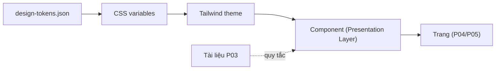

# P03 — DESIGN SYSTEM: WALE COOKING

> Bộ quy chuẩn giao diện **WALE COOKING — Pastel Mint**. Là **nguồn tham chiếu duy nhất** cho mọi phase UI (P03 trở đi).
> Tuân thủ [PRODUCT_CONSTITUTION.md](../P01/PRODUCT_CONSTITUTION.md) (đặc biệt PC-05/06/07/08) và định hướng đã chốt tại [02-dinh-huong-giao-dien.md](../P00/02-dinh-huong-giao-dien.md).
> P03 **chỉ đặc tả** design system + tokens; **không triển khai** component trong app (thuộc P04/P05).

## 1. Mục tiêu & phạm vi

**Mục tiêu:** khóa toàn bộ quy chuẩn màu, chữ, khoảng cách, component, chuyển động và trợ năng để mọi phase sau dùng **thống nhất**, không mỗi trang một kiểu.

**Trong phạm vi P03:** design tokens, bảng màu + audit tương phản, typography & layout, đặc tả component, responsive, motion, accessibility, checklist QA.

**Ngoài phạm vi P03:** viết code component, dựng trang, tạo asset mascot/icon (chờ nguồn asset — B7), triển khai website.

## 2. Cảm giác thương hiệu (Design Direction đã khóa)

- Dễ thương, ấm áp, thân thiện; như **một cuốn sách dạy nấu ăn hiện đại**.
- Sạch sẽ, dễ đọc, không rối mắt; minh họa 2D đáng yêu.
- **Không** dùng phong cách dashboard quản trị khô cứng làm giao diện chính.
- Mobile-first nhưng đẹp trên desktop.

**Hệ quả thiết kế (bắt buộc tuân thủ):**
- Nền kem ấm (`#FFF9F0`), card bo góc lớn (18–24px), shadow **ấm và nhẹ**, không glassmorphism.
- Nhịp thở rộng rãi (spacing ≥ 4px base), chữ body dễ đọc (Nunito, line-height ≥ 1.6).

## 3. Cấu trúc bộ tài liệu P03

| Tài liệu | Nội dung |
| --- | --- |
| [DESIGN_SYSTEM.md](./DESIGN_SYSTEM.md) | Tổng quan, nguyên tắc, governance (file này) |
| [DESIGN_TOKENS.md](./DESIGN_TOKENS.md) | Tra cứu token (màu/chữ/spacing/…) |
| [COLOR_ACCESSIBILITY_AUDIT.md](./COLOR_ACCESSIBILITY_AUDIT.md) | **Số liệu contrast đo thực tế** + pass/fail |
| [TYPOGRAPHY_AND_LAYOUT.md](./TYPOGRAPHY_AND_LAYOUT.md) | Type scale + grid/layout |
| [COMPONENT_SPECIFICATIONS.md](./COMPONENT_SPECIFICATIONS.md) | Đặc tả 30+ component |
| [RESPONSIVE_GUIDELINES.md](./RESPONSIVE_GUIDELINES.md) | Breakpoint + hành vi navigation |
| [MOTION_GUIDELINES.md](./MOTION_GUIDELINES.md) | Chuyển động & tương tác |
| [ACCESSIBILITY_GUIDELINES.md](./ACCESSIBILITY_GUIDELINES.md) | WCAG 2.2 AA + quy tắc theo component |
| [DESIGN_QA_CHECKLIST.md](./DESIGN_QA_CHECKLIST.md) | Checklist nghiệm thu |
| [tokens/design-tokens.json](./tokens/design-tokens.json) | Token máy đọc được |

## 4. Quan hệ với kiến trúc P02

Design System **không** thay đổi kiến trúc P02. Nó cung cấp lớp token cho **Presentation Layer**:
- Token → CSS variables → Tailwind theme (đề xuất ở [P00 §7](../P00/02-dinh-huong-giao-dien.md)).
- Component đặc tả ở đây sẽ được hiện thực trong Presentation Layer (Server/Client Component theo [SYSTEM_ARCHITECTURE.md](../P02/SYSTEM_ARCHITECTURE.md) §4).
- Font tải qua `next/font` (Baloo 2, Nunito) để tránh nhảy layout (CLS) — phục vụ NFR-PERF.

## 5. Nguyên tắc sử dụng (bắt buộc)

1. **Không màu ngoài Design System.** Mọi màu lấy từ token; không hardcode HEX trong component.
2. **Không giá trị spacing tùy tiện.** Dùng thang `space`.
3. **Chỉ 2 font:** Baloo 2 (heading) · Nunito (body). Không phase nào tự chọn font khác.
4. **Card bo góc 18–24px** (`radius.lg`/`radius.xl`).
5. **Màu brand gốc bất biến.** Khi cần tương phản, dùng **shade phụ trợ** (`primary.*`, `border.*`, `text.*`), không sửa brand.
6. **Không tuyên bố đạt WCAG** khi chưa có số liệu đo (xem audit).
7. **Mobile-first**: thiết kế cho `320px` trước, mở rộng lên.
8. **Tôn trọng `prefers-reduced-motion`.**
9. **Mọi ảnh có `alt`;** mọi control có label (PC-07).
10. **Không dùng tài nguyên hình ảnh không rõ bản quyền.**

## 6. Governance (thay đổi Design System)

- Thay đổi token/màu/font → phải ghi **lý do + đánh đổi** vào [DECISIONS.md](../../DECISIONS.md) và cập nhật `design-tokens.json` + audit.
- Thêm component mới → bổ sung vào [COMPONENT_SPECIFICATIONS.md](./COMPONENT_SPECIFICATIONS.md) theo cùng template (mục đích/cấu trúc/màu/typography/trạng thái/a11y).
- Không đổi màu brand gốc (`color.brand.*`) nếu chưa được phê duyệt.

## 7. Bàn giao & truy vết

| Yêu cầu P03 | Đáp ứng |
| --- | --- |
| Khóa màu + semantic + shade | [COLOR_ACCESSIBILITY_AUDIT.md](./COLOR_ACCESSIBILITY_AUDIT.md), [DESIGN_TOKENS.md](./DESIGN_TOKENS.md) §2 |
| Typography scale | [TYPOGRAPHY_AND_LAYOUT.md](./TYPOGRAPHY_AND_LAYOUT.md) §2 |
| Layout/spacing/grid | [TYPOGRAPHY_AND_LAYOUT.md](./TYPOGRAPHY_AND_LAYOUT.md) §3–4 |
| Component spec | [COMPONENT_SPECIFICATIONS.md](./COMPONENT_SPECIFICATIONS.md) |
| Radius/shadow/elevation | [DESIGN_TOKENS.md](./DESIGN_TOKENS.md) §6–7 |
| Motion | [MOTION_GUIDELINES.md](./MOTION_GUIDELINES.md) |
| Accessibility | [ACCESSIBILITY_GUIDELINES.md](./ACCESSIBILITY_GUIDELINES.md) |
| Tokens JSON | [tokens/design-tokens.json](./tokens/design-tokens.json) |
