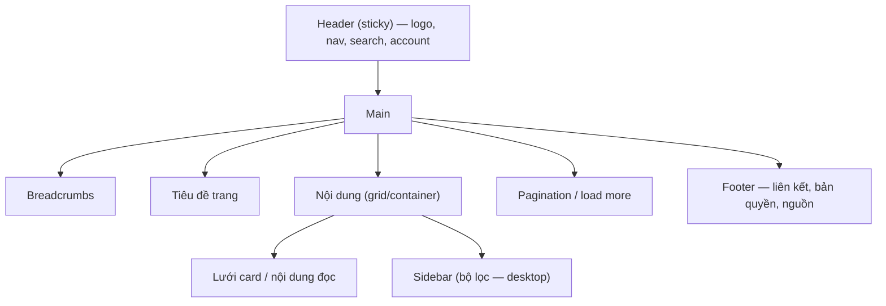

# P03 — TYPOGRAPHY & LAYOUT: WALE COOKING

> Chi tiết chữ và bố cục. Token tương ứng trong [tokens/design-tokens.json](./tokens/design-tokens.json) (`typography`, `space`, `grid`, `container`).

## 1. Font family (KHÓA)

| Vai trò | Font | Fallback |
| --- | --- | --- |
| Heading | **Baloo 2** | `'Segoe UI', system-ui, -apple-system, 'Helvetica Neue', Arial, sans-serif` |
| Body | **Nunito** | `'Segoe UI', system-ui, -apple-system, 'Helvetica Neue', Arial, sans-serif` |

- Cả hai font **hỗ trợ tiếng Việt**.
- Tải qua `next/font` (self-host, `display: swap`) để tránh nhảy layout (CLS — NFR-PERF).
- Nếu Google Fonts lỗi → dùng fallback trong chuỗi trên; **không** tự đổi sang font khác.
- Chỉ **hai** font này trong toàn bộ giao diện.

## 2. Type scale

| Cấp | Font | Size (mobile → desktop) | Weight | Line-height | Letter-spacing |
| --- | --- | --- | --- | --- | --- |
| Display | Baloo 2 | 34 → 48px | 700 | 1.1 | −0.02em |
| H1 | Baloo 2 | 28 → 36px | 700 | 1.15 | −0.01em |
| H2 | Baloo 2 | 24 → 30px | 700 | 1.2 | −0.01em |
| H3 | Baloo 2 | 20 → 24px | 600 | 1.25 | 0 |
| H4 | Baloo 2 | 18 → 20px | 600 | 1.3 | 0 |
| Body large | Nunito | 18px | 400 | 1.6 | 0 |
| Body | Nunito | 16px | 400 | 1.65 | 0 |
| Body small | Nunito | 14px | 400 | 1.6 | 0 |
| Caption | Nunito | 13px | 500 | 1.5 | 0.01em |
| Label | Nunito | 14px | 600 | 1.4 | 0.01em |
| Button | Nunito | 14 (sm) / 16 / 18 (lg) | 600 | 1.2 | 0.01em |
| Navigation | Nunito | 15px | 600 | 1.4 | 0.01em |

**Ví dụ minh họa (mô tả trực quan):**
- **Display** — dùng cho hero trang chủ: *"Nấu ngon mỗi ngày"* (Baloo 2, 48px, nâu `#594B40`).
- **H1** — tiêu đề trang chi tiết: *"Phở bò Hà Nội"*.
- **H3** — tiêu đề khối: *"Nguyên liệu"*, *"Các bước thực hiện"*.
- **Body** — mô tả công thức, hướng dẫn bước (Nunito 16px, line-height 1.65 để dễ đọc khi nấu).
- **Caption** — ghi nguồn/định lượng phụ: *"Ảnh: nguồn tham khảo"*, *"≈ 250 kcal / khẩu phần"*.

### 2.1. Quy tắc dùng chữ mobile vs desktop
- **Heading giảm cấp trên mobile:** chỉ `display/h1/h2/h3/h4` đổi size; body/caption/label giữ nguyên.
- **Không** dùng size chữ < 13px cho nội dung (chỉ caption tối thiểu 13px; tuyệt đối không < 12px).
- **Chế độ nấu (cooking mode):** tăng body lên **20–22px** và line-height 1.7 (điều chỉnh bằng modifier `cooking`, không tạo font mới). Xem [RESPONSIVE_GUIDELINES.md](./RESPONSIVE_GUIDELINES.md#5-chế-độ-nấu-cooking-mode).
- **Số liệu định lượng:** dùng `font-variant-numeric: tabular-nums` để cột số thẳng hàng.

### 2.2. Giới hạn độ dài dòng
- Nội dung đọc (mô tả, hướng dẫn): tối đa **68ch** (`size.lineWidth.prose`) để dễ đọc.

## 3. Spacing scale

Base **4px**:

| Token | px | Ứng dụng điển hình |
| --- | --- | --- |
| `space.1` | 4 | Khoảng hở icon–chữ |
| `space.2` | 8 | Trong chip, gap nhỏ |
| `space.3` | 12 | Padding input dọc phụ |
| `space.4` | 16 | Padding card (mobile), gap mặc định |
| `space.5` | 20 | Padding ngang control |
| `space.6` | 24 | Padding card (desktop), gap khối |
| `space.8` | 32 | Khoảng giữa nhóm |
| `space.10` | 40 | Khoảng giữa section (mobile) |
| `space.12` | 48 | Khoảng giữa section (desktop) |
| `space.16` | 64 | Section lớn |
| `space.20/24` | 80/96 | Hero, khoảng lớn trên desktop |

## 4. Layout & grid

| Thuộc tính | Mobile (0–639) | Tablet (640–1023) | Desktop (≥1024) |
| --- | --- | --- | --- |
| Columns | 4 | 8 | 12 |
| Gutter | 16px | 24px | 24px |
| Margin (lề trang) | 16px | 24px | 32px |
| Container | full (có margin) | `container.default` 1024px | `container.wide` 1200px |

- **Container nội dung đọc** (bài viết, hướng dẫn): `container.narrow` 720px, canh giữa.
- **Lưới thẻ công thức:** 1 cột (mobile) → 2 cột (tablet) → 3–4 cột (desktop).
- Không có cuộn ngang ở `320px` (NFR-RESP).

## 5. Quy ước spacing (bắt buộc)

| Ngữ cảnh | Quy ước |
| --- | --- |
| Padding card | `space.4` (mobile) → `space.6` (desktop) |
| Gap giữa các card trong lưới | `space.4` (mobile) → `space.6` (desktop) |
| Khoảng giữa các section | `space.10` (mobile) → `space.12` (desktop) |
| Khoảng giữa field trong form | `space.4` (dọc) |
| Nhãn ↔ input | `space.2` |
| Thông báo lỗi ↔ input | `space.1` |
| Icon ↔ nhãn button | `space.2` |
| Heading ↔ nội dung theo sau | `space.3` |
| Tiêu đề section ↔ lưới nội dung | `space.6` |

**Cấm:** dùng giá trị ngoài thang (ví dụ `padding: 13px`). Nếu thật sự cần → đề xuất bổ sung token.

## 6. Bố cục trang điển hình

## 7. Truy vết

- PC-05 (mobile-first), PC-06 (consistency), NFR-RESP, NFR-PERF.
- Token: `typography.*`, `space.*`, `grid.*`, `container.*`.
